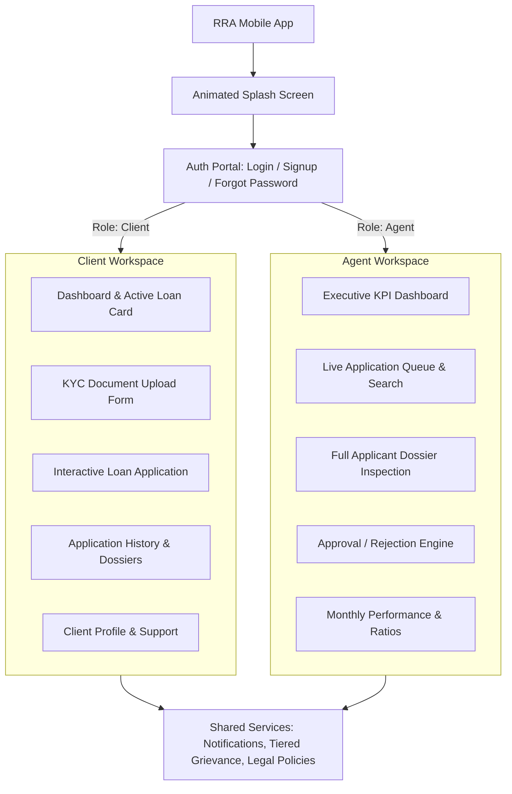

# Ridhi Ratnam Associates (RRA) — Mobile Banking & Loan Application Portal

> **Enterprise-Grade React Native Banking & KYC Verification Ecosystem**  
> *Engineered for High-Reliability Loan Underwriting, Compliant Client Onboarding, and Real-Time Agent Field Operations.*

---

## Table of Contents

1. [Executive Overview](#1-executive-overview)
2. [Core Value Proposition & Dual-Portal Architecture](#2-core-value-proposition--dual-portal-architecture)
3. [Design System & Strict Light Theme Architecture](#3-design-system--strict-light-theme-architecture)
4. [Centralized Colors System (`colors.ts`)](#4-centralized-colors-system-colorsts)
5. [User Roles & Demo Login Credentials](#5-user-roles--demo-login-credentials)
6. [Detailed Screen & Component Breakdown](#6-detailed-screen--component-breakdown)
   - [Authentication & Onboarding Flow](#61-authentication--onboarding-flow)
   - [Client Experience & Self-Service Portal](#62-client-experience--self-service-portal)
   - [Verification Agent & Underwriting Experience](#63-verification-agent--underwriting-experience)
   - [Shared Support, Grievance & Regulatory Screens](#64-shared-support-grievance--regulatory-screens)
7. [Hardware Navigation & Android Back Button Logic](#7-hardware-navigation--android-back-button-logic)
8. [Regulatory Compliance, Security & Data Governance](#8-regulatory-compliance-security--data-governance)
9. [Technology Stack & Dependencies](#9-technology-stack--dependencies)
10. [Comprehensive Codebase Directory Map](#10-comprehensive-codebase-directory-map)
11. [Installation & Local Development Guide](#11-installation--local-development-guide)
12. [Testing & Quality Assurance Suite](#12-testing--quality-assurance-suite)
13. [Native Android & iOS Production Builds](#13-native-android--ios-production-builds)
14. [Troubleshooting & Frequently Asked Questions](#14-troubleshooting--frequently-asked-questions)
15. [Project Roadmap & Production Deployment Readiness](#15-project-roadmap--production-deployment-readiness)

---

## 1. Executive Overview

**Ridhi Ratnam Associates (RRA)** is a modern, high-performance mobile application built with **React Native 0.88.1**, **React 19.3**, and **TypeScript 6**. The platform addresses the critical workflow divide in retail lending: empowering **loan applicants (Clients)** to effortlessly upload identity documentation, calculate loan eligibility, and monitor real-time approval milestones while providing **Verification Agents** with an institutional-grade underwriting cockpit to inspect dossiers, audit documentation, and render credit decisions.

The application adheres strictly to modern banking UI/UX principles:
- **Corporate Navy (`#012655`)** and **Warm Antique Gold (`#CDA148`)** brand identity.
- **Strict Light Theme** enforcement across all components, modals, and screens for maximum visual clarity in daylight and field settings.
- **100% Zero-Hex-In-Code Enforcement**: All styling throughout the entire source repository references centralized theme tokens from `src/theme/colors.ts`.
- **Custom Stack-State Navigator** with deterministic Android hardware back-button handling, preventing premature app closure.
- **Pre-Integrated Mock Repository Layer** simulating asynchronous network latencies, validation errors, and document processing without external database dependencies.

---

## 2. Core Value Proposition & Dual-Portal Architecture

The RRA architecture provides two specialized interfaces decoupled at the authorization boundary:



### Key Differences Between Portals:
| Architectural Dimension | Client Experience | Agent Field Experience |
| :--- | :--- | :--- |
| **Primary Goal** | Document submission, loan discovery, milestone tracking | Application auditing, KYC validation, credit sanctioning |
| **Navigation Model** | 3-Pill Bottom Nav (Home, Upload/Apply Peanut, Profile) | Conjoined Dual-Capsule Bottom Nav (Dashboard, Applications, History, Settings) |
| **Financial Tools** | Live EMI Estimator, Real-Time FOIR Debt Capacity Gauge | Sanctioned vs. Requested analysis, CIBIL Bureau score audit |
| **Document Actions** | Camera capture, Gallery picker, PDF upload, Checksum preview | Multi-document cross-examination, verification tagging |
| **Decision Authority** | Self-declaration & credit bureau check consent | Sanction approval, conditional review, rejection with remarks |

---

## 3. Design System & Strict Light Theme Architecture

RRA utilizes a **Strict Light Theme Architecture**. Rather than imposing fragmented dark modes that degrade contrast in field banking environments, all components and screens render on calibrated light canvases:
- **`ThemeContext` Guarantee**: `useAppTheme()` provides `{ isDark: false, colors: lightColors }`.
- **Top Bar Consistency**: Every main screen incorporates the standardized corporate black/navy top header (`colors.topBarBlack` / `colors.brandNavy`) with gold trim (`colors.brandGold`), ensuring visual continuity.
- **Safe Area Insets**: Handled comprehensively with `react-native-safe-area-context` to accommodate Android punch-hole cameras, navigation bars, and iOS Dynamic Island notches.
- **Card Depth & Elevators**: Tactile drop shadows (`colors.shadow`) calibrated with subtle borders (`colors.border`, `colors.borderMedium`, `colors.borderLight`) to eliminate visual clutter.

---

## 4. Centralized Colors System (`colors.ts`)

Every single visual token in the application originates from `src/theme/colors.ts`. The codebase enforces a strict policy preventing hardcoded hex literals in components and style sheets.

### Master Color Token Palette

```typescript
// Located at src/theme/colors.ts
export const colors = {
  // Brand Anchors
  brandNavy: '#012655',              // Deep Corporate Trust Navy
  corporateNavy: '#012655',          // Primary corporate alias
  brandNavyLight: '#08326D',         // Hover/press states
  brandGold: '#CDA148',              // Signature Warm Antique Gold
  brandGoldLight: '#EED8A1',         // Subtle gold border
  brandGoldSoft: '#FEF8E7',          // Soft gold surface pill background
  brandGoldDark: '#9C7523',          // High-contrast gold text
  
  // Base Canvas & Neutral Surfaces
  white: '#FFFFFF',                  // Pure crisp card surface
  black: '#000000',                  // Pure black
  topBarBlack: '#0D0E12',            // High-elegance dark charcoal top bar
  textPrimary: '#0D0E12',            // High-contrast primary typography
  textSecondary: '#64748B',          // Slate 500 secondary labels
  textMuted: '#94A3B8',              // Slate 400 captions & meta
  
  // Slate Scale
  slate50: '#F8FAFC',                // Primary screen background
  slate100: '#F1F5F9',               // Sub-surface & track background
  slate200: '#E2E8F0',               // Neutral card border
  slate300: '#CBD5E1',               // Input border & inactive pill
  slate400: '#94A3B8',               // Icons & muted tags
  slate500: '#64748B',               // Subheaders & descriptions
  slate600: '#475569',               // Table headings & bold notes
  
  // Semantic Status Tokens
  statusApproved: '#047857',         // Approved emerald green
  statusApprovedBg: '#ECFDF5',       // Approved badge fill
  statusApprovedBorder: '#A7F3D0',   // Approved badge border
  statusPending: '#B45309',          // Pending amber/gold text
  statusPendingBg: '#FFFBEB',        // Pending badge fill
  statusPendingBorder: '#FDE68A',    // Pending badge border
  statusReview: '#1D4ED8',           // Under Review blue
  statusReviewBg: '#EFF6FF',         // Under Review badge fill
  statusReviewBorder: '#BFDBFE',     // Under Review badge border
  statusRejected: '#B91C1C',         // Rejected dark crimson text
  statusRejectedBg: '#FEF2F2',       // Rejected badge fill
  statusRejectedBorder: '#FECACA',   // Rejected badge border
  error: '#DC2626',                  // Input error red
  success: '#10B981',                // Metric positive green
  
  // Structural Overlays & Shadows
  overlay: 'rgba(0, 0, 0, 0.45)',    // Modal backdrop scrim
  shadow: '#000000',                 // Cross-platform shadow target
};
```

---

## 5. User Roles & Demo Login Credentials

The application provides out-of-the-box demonstration accounts configured directly in `src/services/kycService.ts`.

### 1. Loan Verification Agent Portal
- **Identifier**: `rahul.agent@ridhiratnam.demo` or `RRA-AG-1024`
- **Password**: `Agent@123`
- **Assigned Identity**: Rahul Sharma (Senior Field Credit Officer, Jaipur Branch)
- **Privileges**: Access to pending queue, ability to view applicant dossiers, approve/reject loans with underwriting comments, and view monthly performance analytics.

### 2. Client Self-Service Portal
- **Identifier**: `amit.client@ridhiratnam.demo` or `RRA-CL-1001` or `+91 9876543210`
- **Password**: `Client@123`
- **Assigned Identity**: Amit Patel (Verified Retail Customer)
- **Privileges**: Upload KYC identity documents, calculate EMI/FOIR ratios, submit new loan applications, review current application status, inspect assigned agent details, and access grievance redressal.

> *Note: For testing convenience, any identifier entered during login that contains the substring `agent` automatically routes to the Agent Dashboard. Any other identifier routes to the Client Portal.*

---

## 6. Detailed Screen & Component Breakdown

### 6.1 Authentication & Onboarding Flow
- **`SplashScreen.tsx`**: Features smooth spring-based scaling of the corporate logo with high-contrast badge typography, validating session state before routing.
- **`AuthScreen.tsx` / `LoginScreen.tsx`**: Interactive segmented role selector (Client vs. Verification Agent), demo credential quick-fill pills, live password visibility toggling, and input validation.
- **`SignupScreen.tsx`**: New applicant registration with real-time field validation (Full Name, 10-digit Indian Mobile `+91`, Email, Password strength, Terms acceptance).
- **`ForgotPasswordScreen.tsx`**: Multi-step identity recovery simulating secure SMS/Email OTP dispatch with countdown timers and secure password reset.

### 6.2 Client Experience & Self-Service Portal
- **`ClientHomeScreen.tsx`**: The master hub orchestrating client operations:
  - **`ClientHeader.tsx`**: Displays personalized greeting, client account tag, notification badge bell, and profile trigger.
  - **`ClientStatCards.tsx`**: 3-card metric strip (Total Applications, Approved Sanctions, Pending Underwriting).
  - **`CurrentApplicationCard.tsx`**: Displays active loan dossier ID, amount, estimated EMI, 6-point document audit badge, assigned advisor contact, and milestone stepper (Application Submitted -> KYC Verified -> Underwriting -> Sanctioned).
  - **`ApplyBannerCard.tsx`**: Financial advancement banner triggering the full loan application form.
  - **`KycUploadBannerCard.tsx`**: Prompts the client to complete mandatory KYC verification.
  - **`KycDocumentUploadForm.tsx`**: Interactive KYC uploader:
    - Dedicated slots for **PAN Card, Aadhaar Card, Address Proof, and Income/Bank Statement**.
    - Choice between **Camera Capture, Device Gallery Image, or PDF Document**.
    - Digital seal and **SHA-256 Checksum preview modal** simulating RBI-compliant local encryption.
  - **`LoanApplicationForm.tsx`**: Comprehensive credit underwriting application:
    - **Loan Type Selection**: Personal Loan, Business Expansion, Machinery & Asset, Home Loan, Vehicle Finance.
    - **Interactive Amount Selector**: Quick pills (₹1L, ₹3L, ₹5L, ₹10L) + custom input with Indian Rupee formatting.
    - **Live EMI Calculator**: Dynamic monthly outflow computation `@ 10.5% p.a.`
    - **Real-Time FOIR Debt Capacity Gauge**: Dynamic calculation of Debt-to-Income ratio `< 50%` with Healthy vs. High-Debt warnings.
    - **Regulatory Consents**: Explicit CIBIL/Experian bureau check authorization and RBI digital lending accuracy declaration checkboxes.
  - **`ClientBottomNav.tsx`**: Unique conjoined dual-capsule ("peanut") navigation featuring separate lobes for Upload and Submission History.

### 6.3 Verification Agent & Underwriting Experience
- **`AgentHomeScreen.tsx`**: The underwriting dashboard:
  - **`DashboardHeader.tsx`**: Displays agent credentials, branch details, notification shortcut, and profile modal trigger.
  - **`StatCard.tsx`**: High-impact KPI grid for Pending Reviews, Approved Files, and Rejected Submissions.
  - **`MonthlyPerformanceCard.tsx`**: Circular progress gauge tracking handled dossiers, approval percentage, and conversion ratios.
  - **`ApplicationCard.tsx`**: Application cards featuring applicant initials avatar, timestamp, amount, and status pill.
  - **`ApplicationDetailModal.tsx`**: Slide-up dossier modal displaying contact details, CIBIL score, loan tenure, underwriting notes, and action triggers.
  - **`ApplicationDetailScreen.tsx`**: Full-screen dossier view with document inspect viewer, remarks textarea, and final Approve/Reject decision triggers.

### 6.4 Shared Support, Grievance & Regulatory Screens
- **`SupportScreen.tsx`**: Complete customer advocacy center:
  - Direct telephone dialer (`1800 234 5678`) and email launcher (`support@ridhiratnam.com`).
  - **Three-Tier Grievance Redressal Architecture**:
    - **Level 1**: Branch Grievance Redressal Officer (TAT: 7 business days).
    - **Level 2**: Principal Nodal Officer (Jaipur Head Office).
    - **Level 3**: RBI Integrated Ombudsman Scheme portal links.
- **`NotificationScreen.tsx`**: Tabbed notification list (All, Loan Updates, Security Alerts) with mark-all-read and dismiss gestures.
- **`NotificationSettingsScreen.tsx`**: Granular push, email, and SMS switches for sanction alerts, interest rate updates, and login notices.
- **`PrivacyPolicyScreen.tsx`**: Comprehensive RBI-compliant digital lending policy detailing KYC data minimization, domestic server storage, and user erasure rights.
- **`TermsAndConditionsScreen.tsx`**: Full institutional terms governing loan sanctions, repayment schedules, interest calculation, and statutory arbitration.

---

## 7. Hardware Navigation & Android Back Button Logic

To ensure professional compliance on Android devices, hardware back-button handling is implemented deterministically in `src/navigation/Navigator.tsx` via React Native's `BackHandler`:

```text
User presses Android Hardware Back Button:
│
├── 1. Is a modal open (Profile, Dossier, Document Preview)?
│      └── YES: Close the modal and consume event (return true).
│
├── 2. Is the user on a sub-screen (Notifications, Support, Privacy, Loan Form)?
│      └── YES: Pop the navigation history stack and return to root dashboard (return true).
│
└── 3. Is the user already on Root Screen (Login, Agent Dashboard, Client Dashboard)?
       └── First Tap: Display Toast/Notification: "Press back again to exit".
       └── Second Tap (< 2000ms): Exit application gracefully.
```

This prevents accidental application termination while filling multi-step loan applications or reviewing financial tables.

---

## 8. Regulatory Compliance, Security & Data Governance

Ridhi Ratnam Associates is modeled after RBI Digital Lending Directives (2022/2023) and Indian FinTech compliance standards:

1. **Explicit Data Consent**: Loan underwriting queries mandate active boolean confirmation before accessing simulated bureau files.
2. **Zero In-Code Secrets**: No production API keys or tokens are stored in the client-side binary.
3. **Audit Trail Verification**: Documents attached within `LoanApplicationForm` and `KycDocumentUploadForm` include simulated SHA-256 integrity hashes.
4. **Three-Tier Grievance Framework**: Transparent escalation paths explicitly documented in `SupportScreen.tsx` in accordance with Ombudsman directives.

---

## 9. Technology Stack & Dependencies

```json
{
  "name": "RidhiRatnamAssociates",
  "version": "0.0.1",
  "dependencies": {
    "react": "19.3.0",
    "react-native": "0.88.1",
    "react-native-safe-area-context": "^5.0.0"
  },
  "devDependencies": {
    "@babel/core": "^7.25.2",
    "@babel/preset-env": "^7.25.2",
    "@babel/runtime": "^7.25.0",
    "@react-native/babel-preset": "0.88.1",
    "@react-native/eslint-config": "0.88.1",
    "@react-native/metro-config": "0.88.1",
    "@react-native/typescript-config": "0.88.1",
    "@types/jest": "^29.5.13",
    "@types/react": "^19.0.0",
    "@types/react-test-renderer": "^19.0.0",
    "eslint": "^8.19.0",
    "jest": "^29.6.3",
    "prettier": "2.8.8",
    "react-test-renderer": "19.3.0",
    "typescript": "^6.0.0"
  }
}
```

---

## 10. Comprehensive Codebase Directory Map

```text
RidhiRatnamAssociates/
├── App.tsx                                  # Application Root with SafeArea & Theme Providers
├── index.js                                 # React Native Entrypoint
├── app.json                                 # Application display metadata
├── package.json                             # Dependencies & Scripts
├── tsconfig.json                            # Strict TypeScript configuration
├── jest.config.js                           # Test runner configuration
├── __tests__/                               # 12 Unit & Integration Test Suites
│   ├── AgentDashboard.test.tsx              # Agent metrics & dossier tests
│   ├── App.test.tsx                         # Root app mount tests
│   ├── ApplicationDetail.test.tsx           # Full dossier screen tests
│   ├── AuthFlow.test.tsx                    # Login, signup & role switching tests
│   ├── BackHandlerNavigation.test.tsx       # Android back button stack tests
│   ├── ClientDashboard.test.tsx             # Client dashboard & form tests
│   ├── NotificationAndProfileScreens.test.tsx # Notification & profile tests
│   ├── NotificationSettingsScreen.test.tsx  # Push/SMS settings tests
│   ├── PrivacyPolicyScreen.test.tsx         # Privacy legal document tests
│   ├── SupportScreen.test.tsx               # Grievance redressal & support tests
│   ├── TermsAndConditionsScreen.test.tsx    # Terms legal document tests
│   └── ThemeDialog.test.tsx                 # Alert & Dialog modal tests
├── src/
│   ├── components/                          # Core UI Primitives & Components
│   │   ├── AnimatedButton.tsx               # Polished haptic/animated CTA button
│   │   ├── AvatarCluster.tsx                # Client initial avatar groupings
│   │   ├── BrandLogo.tsx                    # Corporate logo vector render
│   │   ├── CustomInput.tsx                  # Accessible validated text input with inline errors
│   │   ├── Icons.tsx                        # Complete set of 30+ lightweight SVG-style vector icons
│   │   ├── PillChip.tsx                     # Filter chips & status capsules
│   │   ├── RoleSelector.tsx                 # Client vs. Agent toggle control
│   │   ├── ScreenHeader.tsx                 # Standardized corporate top bar
│   │   ├── ThemeDialog.tsx                  # Theme-aware custom modal dialogs & alerts
│   │   ├── client/                          # Client-Specific Components
│   │   │   ├── ApplyBannerCard.tsx          # Loan promotion banner
│   │   │   ├── ClientAppDetailModal.tsx     # Client active dossier modal
│   │   │   ├── ClientBottomNav.tsx          # Client 3-pill bottom navigation
│   │   │   ├── ClientHeader.tsx             # Client personalized greeting header
│   │   │   ├── ClientStatCards.tsx          # Client application metric pills
│   │   │   ├── CurrentApplicationCard.tsx   # Active loan tracker & milestone stepper
│   │   │   ├── KycDocumentUploadForm.tsx    # KYC multi-document uploader & cert preview
│   │   │   ├── KycStatusCard.tsx            # Current KYC review state card
│   │   │   ├── KycUploadBannerCard.tsx      # KYC completion reminder banner
│   │   │   ├── LoanApplicationForm.tsx      # Loan application with EMI & FOIR calculators
│   │   │   ├── RecentApplicationsSection.tsx # Recent 3 applications list
│   │   │   └── SupportCard.tsx              # Quick assistance & direct dialer card
│   │   └── dashboard/                       # Agent-Specific Components
│   │       ├── AgentInfoCard.tsx            # Agent designation & branch badge
│   │       ├── ApplicationCard.tsx          # Underwriter queue item card
│   │       ├── ApplicationDetailModal.tsx   # Quick dossier evaluation bottom sheet
│   │       ├── BottomNavBar.tsx             # Conjoined dual-capsule agent navigation
│   │       ├── DashboardHeader.tsx          # Agent corporate header
│   │       ├── MonthlyPerformanceCard.tsx   # Performance circular gauge
│   │       ├── ProfileModal.tsx             # Agent quick profile & logout modal
│   │       └── StatCard.tsx                 # Underwriting KPI counter card
│   ├── constants/
│   │   └── app.ts                           # Global brand strings, branch names, contact details
│   ├── navigation/
│   │   └── Navigator.tsx                    # Stack-State Navigator with hardware back handling
│   ├── screens/                             # Top-Level Screen Controllers
│   │   ├── AgentHomeScreen.tsx              # Agent operational dashboard
│   │   ├── ApplicationDetailScreen.tsx      # Full underwriting dossier screen
│   │   ├── AuthScreen.tsx                   # Master authentication screen
│   │   ├── ClientHomeScreen.tsx             # Client portal master screen
│   │   ├── ForgotPasswordScreen.tsx         # Account recovery & OTP flow
│   │   ├── LoginScreen.tsx                  # Dedicated login controller
│   │   ├── NotificationScreen.tsx           # Notifications management screen
│   │   ├── NotificationSettingsScreen.tsx   # Communication preferences screen
│   │   ├── PrivacyPolicyScreen.tsx          # RBI compliance privacy disclosure
│   │   ├── ProfileScreen.tsx                # Client user profile & settings
│   │   ├── SignupScreen.tsx                 # Client self-registration screen
│   │   ├── SplashScreen.tsx                 # Animated entry splash screen
│   │   ├── SupportScreen.tsx                # Three-tier grievance & support desk
│   │   └── TermsAndConditionsScreen.tsx     # Institutional terms of service
│   ├── services/                            # Data Repositories & In-Memory Services
│   │   ├── clientService.ts                 # Client data access & loan creation
│   │   ├── dashboardService.ts              # Agent queue, metrics & underwriting remarks
│   │   └── kycService.ts                    # Auth repository & KYC document state
│   ├── theme/                               # Design Tokens & Styling Primitives
│   │   ├── colors.ts                        # Master 100% centralized color token system
│   │   ├── shadows.ts                       # Standardized elevation & shadow styles
│   │   ├── typography.ts                    # Font scale & weight tokens
│   │   └── index.ts                         # ThemeContext & useAppTheme hook
│   └── types/                               # TypeScript Domain Models
│       ├── client.ts                        # Client applications, steps & stats
│       ├── dashboard.ts                     # Agent profiles, performance & filters
│       └── kyc.ts                           # KYC document configurations & submissions
```

---

## 11. Installation & Local Development Guide

### Prerequisites
- **Node.js**: `>= 22.11.0` (LTS recommended)
- **Package Manager**: `npm` (v10+)
- **Android Development**: Android Studio, JDK 17, Android SDK Platform 34+
- **iOS Development (macOS only)**: Xcode 15+, CocoaPods, Ruby Bundler

### Step 1: Clone the Repository
```bash
git clone https://github.com/LovejeetSinghCyberbells/Ridhi-Ratnam-Associates.git
cd Ridhi-Ratnam-Associates
```

### Step 2: Install Node Dependencies
```bash
npm install
# or for strict reproducible install:
npm ci
```

### Step 3: Configure Native Dependencies
For iOS (macOS only):
```bash
cd ios
bundle install
bundle exec pod install
cd ..
```

### Step 4: Start the Metro Bundler
```bash
npm start
# or reset cache if dependencies changed:
npm start -- --reset-cache
```

### Step 5: Run on Target Platform
In a separate terminal window:
```bash
# Run on connected Android device or running emulator:
npm run android

# Run on iOS simulator (macOS only):
npm run ios
```

---

## 12. Testing & Quality Assurance Suite

The project includes 12 comprehensive Jest test suites covering 69 unit and integration scenarios:

```bash
# Run all tests
npm test -- --watchAll=false

# Run with serial band execution for debugging
npm test -- --runInBand

# Run a specific test suite
npm test -- __tests__/AuthFlow.test.tsx
npm test -- __tests__/ClientDashboard.test.tsx
npm test -- __tests__/BackHandlerNavigation.test.tsx
```

### Test Suite Summary
| Test Suite | Focus Area | Status |
| :--- | :--- | :--- |
| `BackHandlerNavigation.test.tsx` | Android hardware back button & stack navigation | PASS |
| `AuthFlow.test.tsx` | Role switching, demo accounts, validation | PASS |
| `ClientDashboard.test.tsx` | KYC forms, loan calculation, status stepper | PASS |
| `AgentDashboard.test.tsx` | Underwriting queue, status filters, KPI cards | PASS |
| `ApplicationDetail.test.tsx` | Dossier inspection, approval/rejection comments | PASS |
| `NotificationAndProfileScreens.test.tsx` | Profile details, notification mark-read | PASS |
| `NotificationSettingsScreen.test.tsx` | Communication toggle preferences | PASS |
| `SupportScreen.test.tsx` | Three-tier grievance redressal & dialers | PASS |
| `PrivacyPolicyScreen.test.tsx` | RBI digital lending disclosure rendering | PASS |
| `TermsAndConditionsScreen.test.tsx` | Financial terms & arbitration clauses | PASS |
| `ThemeDialog.test.tsx` | Custom alert dialog presentation | PASS |
| `App.test.tsx` | Root provider mounting & splash transition | PASS |

**Result**: `12 passed, 12 total (69 tests passed, 0 failures).`

---

## 13. Native Android & iOS Production Builds

### Android Release APK Generation
1. Navigate to the `android/` directory:
   ```bash
   cd android
   ```
2. Clean existing Gradle build artifacts:
   ```bash
   ./gradlew clean
   ```
3. Assemble the release build:
   ```bash
   ./gradlew assembleRelease
   ```
   *(Or for debug testing: `./gradlew assembleDebug`)*
4. The generated APK will be available at:
   ```text
   android/app/build/outputs/apk/release/app-release.apk
   ```

### iOS Archive (macOS)
1. Open the native workspace:
   ```bash
   open ios/RidhiRatnamAssociates.xcworkspace
   ```
2. Select **Product > Scheme > RidhiRatnamAssociates**.
3. Select **Any iOS Device (arm64)**.
4. Select **Product > Archive** to build the distribution bundle for TestFlight or App Store deployment.

---

## 14. Troubleshooting & Frequently Asked Questions

#### Q1: Why does pressing the Android back button not close the app immediately?
> **Answer**: By design. RRA implements professional Android hardware back handling. On sub-screens or modals, pressing back navigates up the hierarchy or dismisses the modal. On root screens, double-tapping back within 2 seconds exits the app, preventing accidental data loss during form entry.

#### Q2: Where do I change the application colors?
> **Answer**: All colors are consolidated in `src/theme/colors.ts`. Modifying values in `colors.ts` automatically propagates across all screens, navigation bars, modals, icons, and text components.

#### Q3: How do I test the Agent view versus the Client view?
> **Answer**: On the login screen, use the demo quick-fill pills or enter `rahul.agent@ridhiratnam.demo` (`Agent@123`) for Agent mode, or `amit.client@ridhiratnam.demo` (`Client@123`) for Client mode.

#### Q4: Metro bundler throws port 8081 collision.
> **Answer**: Terminate any lingering Node processes:
> ```bash
> lsof -nP -iTCP:8081 -sTCP:LISTEN
> kill -9 <PID>
> npm start -- --reset-cache
> ```

---

## 15. Project Roadmap & Production Deployment Readiness

- [x] **Light-Theme-First UI System**: Complete removal of dark mode for consistent banking compliance.
- [x] **100% Zero-Hex Policy**: All hex codes abstracted into `src/theme/colors.ts`.
- [x] **Multi-Step KYC Document Upload**: Camera, gallery, and PDF support with preview modal.
- [x] **Credit Underwriting Form**: Live EMI estimator and FOIR debt capacity calculator.
- [x] **Android Hardware Back Handler**: Stack navigation and double-tap exit.
- [x] **RBI Grievance Escalation**: 3-tier redressal framework embedded in support.
- [ ] **Phase 2 (Backend Integration)**: Connect REST / GraphQL endpoints to replace `kycService` in-memory repositories.
- [ ] **Phase 3 (Live e-KYC & Digilocker)**: Plug in UIDAI Aadhaar OTP and Digilocker SDKs for automated credential pulling.
- [ ] **Phase 4 (Push Notifications)**: Integrate Firebase Cloud Messaging (FCM) / Apple APNs for live sanction alerts.

---

*Copyright © 2026 Ridhi Ratnam Associates. All rights reserved.*
